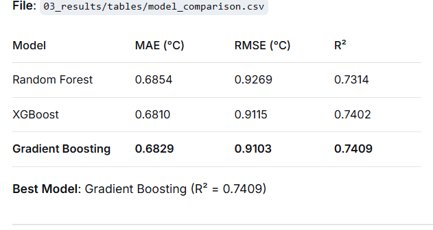

Data Assets
Asset	Description
24 satellite rasters	NDVI, NDBI, LST, LST_Night × 6 years
37,890-row master CSV	All extracted values
6,315 grid cells	500m analysis units
2030 prediction CSV	Predicted LST for all cells
Health/economic tables	Impact estimates

Analysis Results
Result	Value
LST warming (2000–2025)	+1.24°C
Nighttime warming	+1.94°C
NDBI–LST correlation	r = 0.613 (p < 0.001)
ML model R²	0.741
NDBI importance	55%
2030 predicted warming	+0.25°C
Population exposed >30°C by 2030	352,336 (+51%)
Health burden (2030)	18 deaths, 177 hospitalizations, 729 ED visits
Economic burden (2030)	$186M USD/year ($7.43/person)
